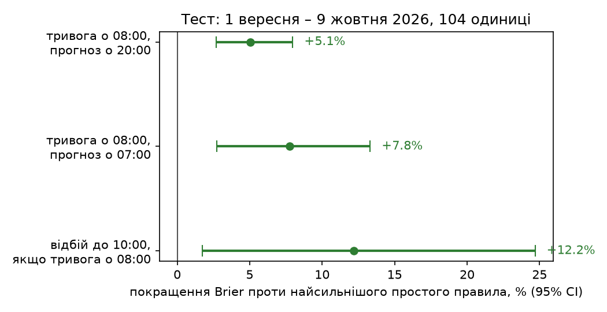
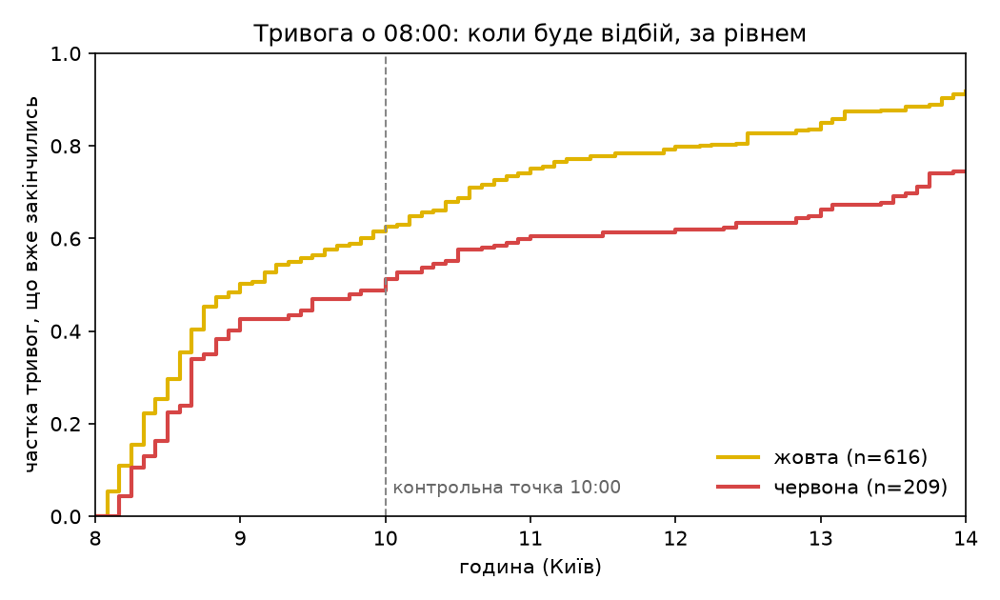
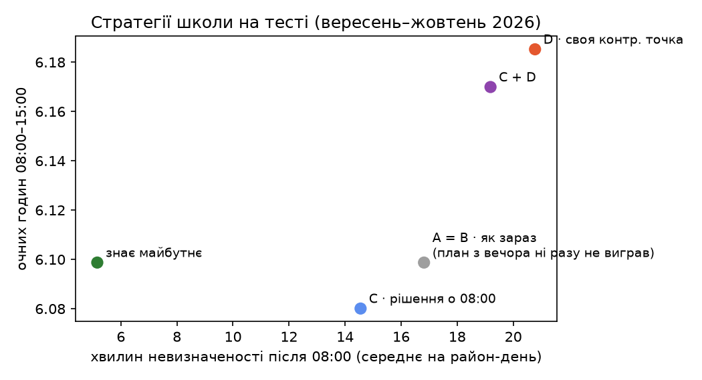
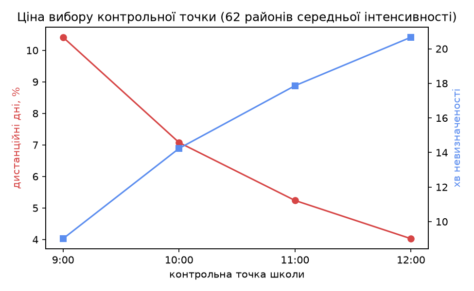

# School mornings under air raid alerts

**Forecasting, per raion, whether a school day will start under alert and whether the all-clear will come in time, evaluated on the latest five weeks with no leakage.**

KSE Agentic AI School 2026, Stage 2. Time series analysis of air raid alerts in Ukraine.

> **Коротко українською.** Школа щоранку вирішує за правилом МОН (лист №1/19575 від 11.09.2026). Якщо о 08:00 тривога, день починається дистанційно. Якщо відбій приходить до контрольної точки (наприклад, 10:00), діти йдуть на очне навчання, інакше весь день дистанційний. Ми прогнозуємо по кожному району ймовірність тривоги о 08:00 (о 20:00 напередодні і о 07:00), ймовірність відбою до контрольної точки і ціну різних стратегій школи. Перевірено на 1.09–9.10.2026.
>
> Результати (після виправлень за незалежним аудитом; числа до аудиту теж показані нижче):
> - **Усі три прогнози значуще кращі** за найсильніше просте правило: о 07:00 на +7.8%, о 20:00 на +5.1%, відбій до 10:00 на +12.2%.
> - Найбільший виграш для шкіл дає **вибір контрольної точки під свій район**.
> - Порайонні тривоги зберегли **1 910 шкільних ранків**.
> - Після дедлайну (12.10): кнопка «🕐 Ризик по годинах». Модель краща за історію лише **коли тривога вже йде**: на годину вперед на +16%, на 2–3 год на +8% і +5%. **Якщо тривоги немає, наступну вона не передбачає** краще за «як часто була тривога о цій годині за 28 днів», тож бот показує саме цю частку і прямо каже, що це історія. Деталі [нижче](#risk-by-hour-and-recent-alerts-after-submission-12-oct).

## The decision

Ministry of Education letter №1/19575 (11 Sep 2026) sets the rule, checked in the primary source:

- if an alert is active when the school day starts, the day starts remotely;
- the school sets a **control point** in advance (e.g. 10:00): an all-clear before it means in-person lessons after a ~60 min transition, an all-clear after it means the whole day is remote;
- more than 2 hours of alerts per school day for several days in a row means changing the learning model.

So three questions matter, for each raion:

| | Asked at | Question |
|---|---|---|
| **M1** | 20:00 the evening before, and 07:00 | Will an alert be active at 08:00? |
| **M2** | 08:00, if an alert is on | Will the all-clear come by 10:00 (11:00, …)? |
| **M3** | ahead of time | Which strategy gives the most in-person hours with the least time in limbo? |

## Data, and what was wrong with it

| Source | Used for | Finding |
|---|---|---|
| [Vadimkin dataset](https://github.com/Vadimkin/ukrainian-air-raid-sirens-dataset), official feed | 15 Dec 2025 → 27 Aug 2026 | **38% exact duplicate rows**. **Outage 29 Aug – 2 Sep** (0 alerts on 30 Aug – 1 Sep while the volunteer feed has ~170/day). **Stops on 7 Sep 2026**, when its source channel went silent after the yellow/red reform |
| Telegram [@UkraineAlarmSignal](https://t.me/s/UkraineAlarmSignal), scraped (61 834 posts, 15 Aug → 12 Oct) | 28 Aug → now | Same state signal, with **yellow/red level** and level changes. When the official feed works, the two agree on **96–97% of alert starts within 2 min, both ways** ([source_agreement.csv](results/source_agreement.csv)). 752 posts carry several sections (e.g. a yellow start and an all-clear): the first parser read them as one event; fixed after the audit |
| Kaggle [Massive Missile Attacks on Ukraine](https://www.kaggle.com/datasets/piterfm/massive-missile-attacks-on-ukraine) | days since a mass night, drones in 7 days | A night's report is usable only after it is published (time_end + 2 h) |
| Telegram @kpszsu (Air Force), scraped (36 560 posts, Dec → Oct; threat-post snapshot committed) | candidate features | Kept only for the all-clear model, where they pass the 1-SE rule on validation by a small margin |

Other traps found on the way:
- Three raions **renamed in 2024** had different names in the two sources.
- **Occupied raions** pass a naive "has its own alerts" filter, because the official feed repeats oblast-wide alerts per raion. Donetsk oblast (not zoned, near-permanent alert) and occupied raions are excluded, which leaves **104 units: 103 raions + Kyiv**.
- The series has structural breaks:
  - raion-level alerts nationwide from 15 Dec 2025;
  - jet-drone "streaks" from mid-Aug 2026;
  - restricted Air Force reporting from 11–12 Aug;
  - yellow/red levels from 4–6 Sep;
  - voice-only all-clear from 18 Sep.

Details: [docs/research/01-data-landscape.md](docs/research/01-data-landscape.md).

## Method

Everything a model sees is computed **as of the issue time**. Plain-language walk-through: [docs/how-it-works.md](docs/how-it-works.md).

- **M1 features:**
  - the raion's state now and the minutes since the last alert;
  - alert minutes in 6 h / 24 h / 7 d;
  - share of the oblast and of the country under alert now;
  - the raion's 08:00 alert rate over 28 days;
  - a rolling 42-day Markov probability;
  - days since the last mass night and drones in the last 7 days (published reports only);
  - at 07:00, also the night's alert minutes.
- **M1 models:** logistic regression and gradient boosting (isotonic-calibrated).
- **M2:** Kaplan–Meier baselines (pooled, per oblast), logistic regression, Weibull AFT; time from 08:00 to the all-clear with right-censoring.
- **M3:** in-person hours (08:00–15:00) and "limbo" hours under the MoE rule for:
  - **A**, status quo;
  - **B**, plan the day at 20:00;
  - **C**, call the day at 08:00 using M2;
  - **D**, a per-raion control point chosen on history;
  - **Oracle**, as the ceiling.

**Evaluation was pre-registered** in [PREREG.md](PREREG.md) before the test window was touched:
- train 15 Dec – 31 Jul;
- validation August (model, features, thresholds);
- **test 1 Sep – 9 Oct 2026, run once**;
- baselines: climatology, persistence, rolling Markov; the model must beat the **strongest** one;
- paired block bootstrap over days.

Every change after registration is listed there with its time and reason, including one crashed test run.

**Tests (Python 146, Worker JS 39):** the parser on real post formats (incl. multi-section posts), the MoE rule, censoring, stitching at the source switch, the bot (see below), and **leakage controls** ([tests/test_leakage.py](tests/test_leakage.py)):
- `available_at <= issue_time` on every row;
- **every feature column at 20:00, 07:00 and 08:00** recomputed on a world **truncated at the issue time** equals the full-data value;
- a **mutation test**: a feature made to peek one hour ahead must make that check fail;
- a **planted leak** must trip the guard (AUC > 0.995 aborts);
- attack reports are never available before their window ends; Air Force post counts use only earlier posts.

## Results (test: 1 Sep – 9 Oct 2026, 104 units, 29 weekdays)



**What the percentages mean.**
- **«Тривога о 08:00: 40%».** Of the mornings that get a forecast near 40%, about 4 in 10 should have an alert active at 08:00 in that raion. It is the chance of an alert at that moment, not the share of the raion's area or of the morning under alert. Alerts of both levels (yellow and red) count.
- **«Відбій до 10:00: 70%».** If an alert is on at 08:00, it is the chance it ends by the school's control point. «Увесь день дистанційно» combines the two: P(alert at 08:00) × (1 − P(all-clear in time)).
- **«Зазвичай 23%».** The share of the last 28 mornings with an alert at 08:00 in that raion. This is the climatology baseline the model must beat.
- **Brier skill score**, the headline metric above: how much smaller the model's squared error on these probabilities is than the baseline's. +5% means 5% less error, and 0% means no better. It rewards honest probabilities: a forecast of 40% that comes true 4 times in 10 scores better than a confident 90% that comes true half the time.
- **Risk words in the bot:** 🔕 low < 20%, 🔔 medium 20–49%, 🚨 high ≥ 50%. Bells, not colours, so they never mix with the real yellow and red alert levels.
- **A forecast is not a warning.** Under any real alert, go to the shelter and follow official alerts.

| Question | Model | vs strongest baseline | 95% CI | Criterion | Before the audit fixes |
|---|---|---|---|---|---|
| Alert at 08:00, issued **07:00** | logistic | **+7.8%** Brier skill (vs rolling Markov) | +2.7% … +13.3% | **met** | +6.7% [+1.3, +13.0], met |
| Alert at 08:00, issued **20:00** | logistic | **+5.1%** (vs climatology) | +2.7% … +8.0% | **met** | +2.6% [−3.2, +8.1], not met |
| All-clear by 10:00 | logistic | **+12.2%** (vs Kaplan–Meier, last 60 days) | +1.8% … +24.7% | **met** | +9.2% [−1.0, +21.0], not met |

- **Why there are two sets of numbers.** After the test, an independent code audit (OpenAI Codex, see [below](#independent-audit)) found data bugs that touched the test labels:
  - multi-section posts were misread;
  - censored all-clears were scored as "cleared";
  - alert times were floored to the minute.

  The fixes changed data and labels, not models or thresholds. Both runs are reported. The first run is in [results/archive_before_audit/](results/archive_before_audit/) and in git history.
- **The test period was more intense than training:** an alert was active at 08:00 on **23.2%** of raion-mornings, against ~12% in training. Against plain climatology, the 07:00 model gains +15.3% and the 20:00 model +5.1%.
- **Gradient boosting lost to logistic regression** on validation and on test, so the simpler model is reported.
- **The all-clear model fell from +29% on validation to +12% on test.** The yellow/red reform changed how alerts end (voice-only all-clear from 18 Sep).
- **Air Force threat posts** ("how many Air Force posts mentioned your oblast in the last 1–3 h"): no help for the alert-at-08:00 models (below 1 SE, dropped). For the all-clear model they pass the 1-SE rule on validation by a small margin (gain 0.0022, SE 0.0017), so they are used there.

### All-clear by alert colour (since 6 Sep)

If an alert is on at 08:00, this is the chance of the all-clear by each time (Kaplan–Meier, 825 alerts; [levels_clear_by_time.csv](results/levels_clear_by_time.csv)):

| alert at 08:00 | already running | by 09:00 | **by 10:00** | by 11:00 | by 12:00 |
|---|---|---|---|---|---|
| yellow | < 30 min | 65% | **78%** | 86% | 92% |
| yellow | 30 min – 2 h | 49% | **62%** | 78% | 83% |
| yellow | > 2 h | 37% | **48%** | 61% | 64% |
| red | < 30 min | 66% | **78%** | 91% | 93% |
| red | 30 min – 2 h | 60% | **71%** | 82% | 82% |
| red | > 2 h | 19% | **24%** | 29% | 31% |

The level used is the one **in force at 08:00**, not the maximum over the alert: an alert that turned red at 09:00 was not known to be red at 08:00.
- **The audit changed this table.** The misread multi-section posts had inflated the red rows: 296 → 209 red alerts.
- **What the colour adds as a feature is small:** +1.1% Brier skill when fitted only on earlier days (381 weekday alerts from 21 Sep), down from +5.2% before the fixes. What matters is how long the alert has already run: a red alert past 2 h clears by 10:00 in only 24% of cases.



### What it means for a school (M3)



| Strategy | In-person hours / day | Limbo min / day | Fully remote days |
|---|---|---|---|
| A · status quo, control point 10:00 | 6.10 | 16.8 | 9.7% |
| B · plan a remote day at 20:00 | = A: never triggered | | |
| C · call the day at 08:00 with M2 | 6.08 | 14.5 | 10.1% |
| **D · per-raion control point** | **6.19** | 20.8 | **7.1%** |
| Oracle (knows the all-clear time) | 6.10 | 5.2 | 9.7% |

- **Planning a remote day the evening before never pays off.** On validation its value rises with the threshold until it stops firing: a wrongly cancelled school day costs more than the uncertainty it removes. The evening forecast is information for parents, not a trigger.
- **The biggest lever is the control point.** Choosing it per raion from history (D) gives more in-person hours and fewer fully remote days than the status quo, at the price of a few more minutes of waiting.
- **The 08:00 call (C) cuts limbo** but not in-person hours.

### The price of alerts for schools

From [results/cost_summary.json](results/cost_summary.json):

- **Zoning dividend.** 14.5% of raion school mornings (Jan–May and Sep–Oct 2026) started under alert. If every alert covered the whole oblast, it would be 28.7%: raion-level alerts **saved 1 910 school mornings**.
- **Yellow vs red.** Since 8 Sep, yellow (drone) alerts took **14.9%** of weekday school hours (08:00–15:00) and red **8.9%**. Under КМУ №1092 businesses with shelters may work during yellow, but schools shelter at both levels. Yellow alerts are where school time is lost relative to the rest of the economy.
- **Control point trade-off.** Across 62 mid-intensity raions, moving the control point from 09:00 to 12:00 cuts fully remote days from 10.4% to 4.0% and raises waiting from 9 to 21 minutes a day.



## Live test: Monday 12 Oct 2026

The forecast for this morning was committed **at 00:40, before 08:00** ([brief](results/live/brief_2026-10-12_2000.md)). The 07:00 update was committed at 07:05, and the checks ran at 08:07 and 10:07 ([results/live/](results/live/)).

| | Forecast issued 20:00 (committed 00:40) | Forecast issued 07:00 (committed 07:05) |
|---|---|---|
| Alert at 08:00 | 42 of 104 units (40%); mean forecast 28% | same outcome; mean forecast 28% |
| Brier, alert at 08:00 | 0.187 vs climatology 0.202 (**+7.4%**) | 0.164 vs 0.202 (**+18.5%**) |
| Top-10 highest forecasts | 9 of 10 had an alert | 10 of 10 had an alert |

The table is scored on the corrected alert data. The check run on the morning itself, before the parser fix, counted 43 units under alert and gave +8.5% and +23% ([archived](results/archive_before_audit/check_2026-10-12.md)). The forecasts themselves are unchanged.

**All-clear by 10:00** for the 42 units under alert at 08:00:
- **33 got it (79%).** The brief's per-oblast curve said 65% on average, so it was too pessimistic.
- **It missed in one region.** All five Kharkiv-oblast raions got 61%, and none of them cleared. Zaporizkyi (29%) was right not to clear.

One morning is a noisy sample: it agrees with the test results but proves nothing by itself.

## Independent audit

After the test, OpenAI Codex audited the repository against [docs/codex-audit-prompt.md](docs/codex-audit-prompt.md). Every finding was first **reproduced by hand** before fixing; each fix has a regression test.

| Finding | Effect | Fix |
|---|---|---|
| Multi-section posts parsed as one event (752 posts) | starts recorded as all-clears; some all-clears lost | parse each section ([parse_signal.py](src/airalerts/parse_signal.py)); real post 615287 as a test |
| Times floored to the minute | an alert starting 07:00:40 was "seen" at 07:00:00 | sub-minute precision |
| Censored all-clears scored as "cleared" (2 of 766 test rows) | slightly optimistic M2 labels | unknown outcomes dropped; 24 h-capped alerts = not cleared |
| KM baseline used all training days, not the registered 60 | baseline differed from PREREG | last 60 days |
| Alerts crossing the source switch could vanish | possible missing alert on 28 Aug | intervals clipped at the switch |
| Clean checkout chose a different feature set | results not reproducible without local files | Air Force snapshot committed; `reproduce.sh` checks results against the committed ones |
| Bot: SQLite write locks, lost messages on network errors, 19:45 preparation "seeing" 20:00, forged `rm:0` / `cp:²`, no global rate limit, wrong city ranking (Чернігів → Чернівецький) | bot reliability and safety | fixed, with tests; 40 largest cities resolve correctly |

The truncation test was also extended to every feature at every issue time. A mutation test proves it catches a one-hour peek.

**Round 2 (12 Oct, the hosted bot)**, brief: [docs/codex-audit-cloudflare.md](docs/codex-audit-cloudflare.md). Codex found 20 issues (6 high). 19 are fixed with tests (JS 19/19, Python 88/88). One low one is left on purpose: small differences in how JS and Python answer invalid button data. The JS pause date is the more correct one there.

| Finding | Fix |
|---|---|
| Broadcast read subscribers N+1, so 24 subscribers broke the 50-queries-per-run D1 limit; the batch cap was per slot, not per run | outbox queue: ≤ 30 D1 queries and 40 Telegram calls per run, shared by all slots (test counts them) |
| Overlapping runs could lose a message for good (marked sent before sending) | claims with a token and a 15-min lease; a slow run cannot undo a newer one (test simulates the overlap) |
| Publisher on 25 Oct (25-hour day) skipped Monday's forecast | calendar days, not +24 h |
| `/ingest` took any date, unknown raions, probabilities outside [0, 1] | field-by-field validation; the committed live forecasts pass it |
| HTTP 200 with a broken page renewed the freshness stamp on old data | the scraper fails when the live page has no posts |
| Summer: two cron runs in the window published two versions of a day | the Worker keeps the first version (409); a manual re-run replaces it |
| Shell injection via the manual `force` input; `worker_secrets.env` not git-ignored | input passed through `env` and validated in Python; ignore rule added |
| Rate limits and the three-raion cap could be beaten by parallel taps; long 429s slept through; JS rounding and town search differed from Python | single-statement atomic checks; 429 ends the run; Python's rounding and word boundaries ported |

## After the registered test: fixes, each still checked out of sample

These were designed after seeing the test and the live morning, so they are reported apart from the registered results. Each forecast still uses only days before the forecast day. They are logged in [PREREG.md](PREREG.md), items 6–10. The numbers are on the corrected data.

| Problem found | Fix | Check |
|---|---|---|
| The brief gave every raion of an oblast the same all-clear chance (all five Kharkiv raions got 61% on 12 Oct; none cleared) | All-clear **per raion**, refitted every day on the last 42 days. A raion with few alerts borrows from its oblast ([clearance.py](src/airalerts/clearance.py)) | Rolling, weekdays 15 Sep – 12 Oct, 470 alerts at 08:00. Evening version: +5.0% vs the per-oblast curve [−1.5, +13.3], **not significant** (it was +6.6% before the fixes) |
| The registered all-clear model was trained before the yellow/red reform | The 08:00 version uses the **level in force at 08:00** and the time already elapsed, on post-reform data | **+26.3%** [+14.8, +33.1]. It now gives the brief's 08:00 update per raion: "wait for the control point" or "call the remote day now" |
| Occupied raions were a hand-made list | Share of each raion's area occupied on 31 Aug 2026, from the [DeepState map history](https://github.com/cyterat/deepstate-map-data) and [OPORA raion boundaries](https://github.com/OPORA/map_2020) ([geo.py](src/airalerts/geo.py)) | Selects exactly the hand-listed raions; a test keeps them in agreement |
| Full reproduction needed ~1.5 h of Telegram scraping | Parsed alerts and Air Force threat posts committed as snapshots; `scripts/reproduce.sh` | **2 min 18 s** from a fresh clone; it ends with "results match the committed ones" |
| Would a later evening forecast (21:30, 22:00) or neighbouring raions help? | Tested on validation ([experiments.py](src/airalerts/experiments.py)) | No: neither 21:30/22:00 nor neighbours beat the 20:00 base model on validation. Kept the simpler model |
| Can news predict alerts? Keyword watcher on Lachen (8 570 posts) + Air Force | [events.py](src/airalerts/events.py): mass-attack warnings, truce, retaliation threats | Warnings precede a mass night 1.5× more often but cover only 17% of them, and add nothing meaningful to the 20:00 model (gain 1e-5). After truce news, alerts fell in 5 of 7 cases (n too small to claim). News fits as a banner, not as a feature |

## Risk by hour and recent alerts (after submission, 12 Oct)

A bot button asked for after the deadline: *"is an alert likely in my raion at 15:00 today, or tomorrow?"*, to decide whether to go out now or stay. Post-hoc by construction. Its spec and display rule were committed **before** the backtest ran ([PREREG.md](PREREG.md), item 12; [hourly.py](src/airalerts/hourly.py)).

- **Target:** alert on in the raion at a whole hour h:00, from the next hour up to 23:00 tomorrow (leads 1–47 h).
- **Baseline ("history"):** the share of the last 28 days with an alert at h:00 in that raion.
- **Model:** the baseline adjusted for what is happening now.
  - Alert on: the chance it is still on at h:00, from a Kaplan–Meier curve of alert durations conditional on how long it has already run, plus the chance that a new alert starts after it ends and is still on at h:00.
  - No alert: the chance that an alert starting between now and h:00 is still on at h:00 (start times by hour, per raion, shrunk to the oblast). Far ahead this tends to the baseline.
- **Rolling backtest:** every day 15 Sep – 12 Oct, weekdays and weekends, issued at every hour. 104 raions, 2.4 M forecasts; Brier skill vs the baseline; paired 3-day block bootstrap, as for M1.
- **Leakage:** the truncation test now runs **at every hour of a weekday and a Sunday** (h:00 and h:37). Parameters, state and every forecast up to 23:00 tomorrow must equal what a world cut at that moment gives. A mutation test (the state reads one hour ahead) must fail it.

| Alert at the moment of asking | Lead | Brier skill vs history [95% CI] | Bot shows |
|---|---|---|---|
| **on** | 1 h | **+16.0%** [+7.0, +24.2] | model |
| **on** | 2 h | **+8.0%** [+2.0, +13.9] | model |
| **on** | 3 h | **+4.8%** [+0.8, +9.0] | model |
| **on** | 4–6 h | **+2.3%** [+0.4, +4.3] | model |
| **on** | 7–12 h | +0.4% [+0.1, +0.6] | model |
| on | 13–47 h | 0.0% | history |
| off | 1 h | +1.9% [−1.0, +5.6], not significant | history |
| off | 2–47 h | +0.0 … +0.8%, no CI excludes 0 | history |

The rule: the model is shown only where the CI is above 0 **and** both halves of the period (15–28 Sep, 29 Sep – 12 Oct) agree. Full table: [posthoc_hourly_summary.csv](results/posthoc_hourly_summary.csv); gates the bot reads: [hourly_gates.json](results/hourly_gates.json).

**The honest result is narrow.**
- The model helps **only while an alert is on**, and mostly for the next 1–3 hours: how likely the alert is to still be on, or to be on again.
- **With no alert now, it cannot predict the next one** better than how often there was an alert at that hour over 4 weeks. The bot then shows exactly that share, labelled as history and not as a forecast.
- **It is too low**: 57% at 1 h against 61% observed while an alert is on. Alerts cluster more than independent starts allow. Recalibrating it would need a new period to check on.

**Live data for "now".** Forecasts arrive only twice a day, too stale for "now". So the Worker reads the public web preview of @UkraineAlarmSignal (t.me/s) itself every 5 minutes, at the start of the same cron run that delivers messages, and keeps open and recent alerts per raion in D1. GitHub Actions still runs only twice a day: it sends the hourly parameters and the last 7 days of alerts per raion, and that history heals anything the Worker missed.

| Check (Workers Free plan) | Measured |
|---|---|
| Posts per 5 min since 1 Sep | median 3, 99.9% ≤ 17, max 28; the live page shows 20, the budget is 5 pages (100) per run |
| CPU to parse and apply one real 94 KB page | 0.1 ms warm, ~2 ms cold (limit 10 ms) |
| CPU for an /ingest of the history (255 KB, 3 621 alerts) or parameters (45 KB) | 2.5–3.9 ms cold, incl. validation |
| D1 per scrape run | 4 queries (limit 50); rows written only for alerts that changed |
| Parser parity with Python | 600 real posts incl. multi-section ones: the same 293 episodes; a saved live page: the same 20 posts |
| Model parity with Python | 291 cases incl. the 25 Oct DST switch, equal to 1e-9 |

- **Not testable before deploy:** whether t.me answers requests from Cloudflare's network.
- **If the data are stale or have a hole,** the bot says it does not know the current state and shows history only. This covers a page with no posts, a fetch error, more than 15 minutes since the last good read, or more new posts than the page budget. It never says "no alert" on old data.

**In the bot:**
- **🕐 Ризик по годинах:** pick Сьогодні or Завтра, then an hour (four buttons per row; today starts after the current hour).
- **📜 Останні тривоги:** the last 5 alerts per raion, with start, end and duration, plus today's count and total time. It is pure fact, with no model.
- **While an alert is on,** the screen opens with "be in the shelter, follow official alerts, do not plan to go out before the all-clear". Every screen ends with "for planning, not a safety signal".
- **Callbacks** are whitelisted like the rest: the raion must be one the chat follows, the day 0/1, the hour 0–23 and in the future. 15 forged payloads are tested.

## Evening brief

`python -m airalerts.brief --day 2026-10-13` writes one line per raion: the chance of an alert at 08:00, the chance of an all-clear by 10:00 (per raion), the chance of a fully remote day, and plain advice. `--issue 08:00` gives the morning update: for each raion under alert, the chance of an all-clear by 10:00 given the alert's colour and how long it has run, with "wait" or "call the remote day now". The text comes from a template, with no LLM: every number in it comes straight from the models.

## Telegram bot «Шкільний ранок»

Architecture and design notes: [docs/bot-architecture.md](docs/bot-architecture.md). Code: `src/airalerts/botapp/`. Plain Python over the Telegram Bot API, with no extra libraries and no LLM.

**What a user does:**
- follows up to **3 raions**: picks an oblast and then a raion with buttons, or types a town ("Біла Церква" → Білоцерківський район, via 1 419 hromadas placed inside raion boundaries);
- chooses the school's control point (09–12), the evening delivery time (20:00 / 20:30 / 21:00), the advice style (careful / balanced / bold), morning messages (on alert only / every day), the news banner on or off, and a pause for holidays.

**What the bot sends:**
- **20:00** on school-day evenings: the chance of an alert at 08:00, the chance of an all-clear by *their* control point, and advice;
- **08:05** if an alert is on: its colour, how long it has run, the chance of an all-clear in time, and "wait" or "call the remote day now";
- a **news banner** when a truce, a mass-attack warning or retaliation threats appear in the news: "not confirmed" if only Lachen reports it, "confirmed" if an official channel (President, Air Force) does too. The banner informs and does not change the numbers.

**How it is built to survive in production:**
- forecasts for all 104 raions are computed once and cached (~30 s);
- one message per user per day, logged in SQLite, so a restart sends no duplicates;
- it waits on HTTP 429 and switches off users who blocked the bot (403);
- it stays well below the ~30 messages/s limit;
- it catches up if started late, and a failed job retries at most every 10 minutes.

**Checked:** 18 offline tests with a fake Telegram, including 14 forged button payloads and spam, (every raion reachable by buttons, town search, settings, idempotent broadcast, schedule incl. weekends, 429 retry, banner confirmation). A real-data dry run produced the evening and morning messages for three subscribers with the live banner.

**Hosting (live since 12 Oct):** Cloudflare Workers + D1, free and without a card. The forecasts are computed by GitHub Actions, see [deploy/cloudflare/README.md](deploy/cloudflare/README.md). Alternative: [deploy/README.md](deploy/README.md) (Google Cloud e2-micro, systemd). Independent audit brief: [docs/codex-audit-prompt.md](docs/codex-audit-prompt.md).

```bash
export TELEGRAM_BOT_TOKEN=...          # from @BotFather; never committed
PYTHONPATH=src .venv/bin/python -m airalerts.botapp.main
```

## Limitations

- **One test window of 29 weekdays, in an unusually intense period.** The intervals above reflect that.
- **Under 6 weeks of post-reform data.** The rolling all-clear model refits daily as more accumulates.
- **Different sources for training and test labels.** Training labels come from the official feed and test labels from Telegram (switch on 28 Aug). They agree on 96–97% of alert starts.
- **No "edited" flag on historical Telegram posts** (scraper bug, fixed). About 2.8% of Air Force threat posts were edited, and those features are not used.
- **Not a replacement for official alerts.** No real-time threat positions are used.

## Run

Everything, from a fresh clone, in about 1.5 minutes, using the committed snapshot of parsed alerts:

```bash
./scripts/reproduce.sh
```

From scratch, re-scraping Telegram (~1.5 h):

```bash
python3 -m venv .venv && .venv/bin/pip install -r requirements.txt
export PYTHONPATH=src
.venv/bin/python -m airalerts.sources.vadimkin                                   # official + volunteer feeds
.venv/bin/python -m airalerts.sources.telegram UkraineAlarmSignal --since 2026-08-15
.venv/bin/python -m airalerts.sources.telegram kpszsu --since 2025-12-01        # optional
.venv/bin/python -m airalerts.sources.kaggle                                     # Air Force daily reports
.venv/bin/python -m airalerts.parse_signal
.venv/bin/python -m pytest -q                       # 16 tests: 8 need no data, 8 leakage tests use the data
.venv/bin/python -m airalerts.evaluate              # validation only
.venv/bin/python -m airalerts.evaluate --test       # the registered test run
.venv/bin/python -m airalerts.levels && .venv/bin/python -m airalerts.cost && .venv/bin/python -m airalerts.figures
```

## Repository

| Path | What |
|---|---|
| `src/airalerts/sources/` | Telegram web-preview scraper (no login), dataset downloader |
| `src/airalerts/parse_signal.py` | posts → alert episodes with level timelines |
| `src/airalerts/data.py` | one alert store per raion, source switch, exclusions |
| `src/airalerts/dataset.py`, `attacks.py`, `airforce.py` | as-of-time features |
| `src/airalerts/models.py`, `policies.py`, `evaluate.py` | models, MoE decision rule, registered evaluation |
| `src/airalerts/levels.py`, `cost.py`, `clearance.py`, `geo.py` | all-clear by colour; price of alerts for schools; per-raion all-clear; occupied raions from the map |
| `src/airalerts/hourly.py` | risk by hour per raion (post-hoc, PREREG item 12): model, rolling backtest, parameters for the bot |
| `deploy/cloudflare/worker/` | the hosted bot: Telegram webhook, delivery, live scrape of t.me/s, hourly risk (JS) |
| `data/snapshot/` | parsed alerts (15 Aug – 12 Oct) and occupied shares, for fast reproduction |
| `src/airalerts/brief.py`, `live.py` | evening brief; live forecast and check |
| `PREREG.md` | the registered evaluation and every later change |
| `docs/` | research, the five problems considered, architecture, plain-language explanation |

## Responsible use

The project uses only the start and end times of public alerts, their published level, and published daily reports. It does not show or use real-time movement of threats or air defence (Criminal Code art. 114-2). It is a research project and does not replace official alert signals.
